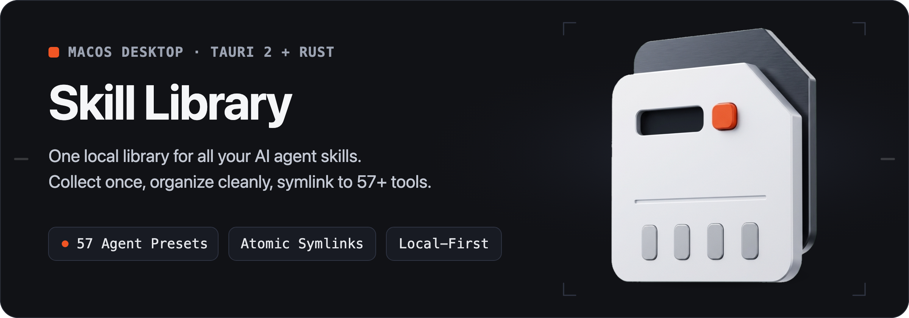
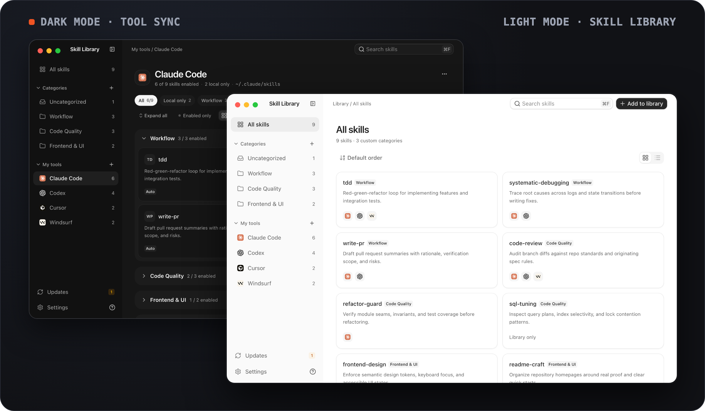
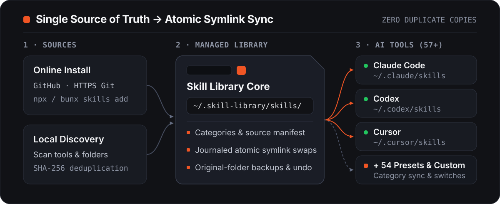

<p align="center">
  
</p>

<p align="center">
  <a href="./README.md">简体中文</a> · <strong>English</strong>
  &nbsp;&nbsp;|&nbsp;&nbsp;
  <a href="#why-skill-library">Features</a> ·
  <a href="#how-it-works">How It Works</a> ·
  <a href="#supported-ai-tools">Supported Tools</a> ·
  <a href="#installation">Installation</a> ·
  <a href="#development">Development</a>
</p>

**Skill Library** is a local-first macOS desktop app (built with **Tauri 2**, **Rust**, and **React 19**) that keeps every AI coding skill in a single managed library (`~/.skill-library/skills/`) and distributes it to **57 built-in AI tool presets** plus custom directories via atomic, crash-safe symlinks.

<p align="center">
  
</p>

---

## Why Skill Library

When you use multiple AI coding agents—such as Claude Code, Codex, Cursor, Windsurf, or Gemini CLI—copies of the same `SKILL.md` folders drift out of sync across hidden directories under `$HOME`. **Skill Library** replaces scattered copies with one maintainable local store:

- **One library, per-tool switches & category sync** — Browse every skill in **All skills**, **Uncategorized**, or custom categories. Toggle individual skills per tool, or flip **Auto-sync** on an entire category with per-skill exclusions and one-click undo.
- **Local scan, SHA-256 deduplication & safe adoption** — Scan existing agent directories and local folders. Identical skill folders are deduplicated by SHA-256 content fingerprint; conflicting versions with the same name show an inline manifest diff before you choose to keep both or standardize on one version.
  - **Local import**: keeps a copy in the library while leaving original files in place.
  - **Adopt**: takes over a tool's installed folder so it links to the library's version, automatically archiving the displaced folder to original-folder backups first.
- **Online install & Skill updates (`Updates`)** — Install directly from:
  - HTTPS Git URLs (including `#ref=...`)
  - GitHub repository shorthand (`owner/repo`) and folder URLs (`https://github.com/<owner>/<repo>/tree/...`)
  - Package commands (`npx`, `pnpx`, `pnpm dlx`, `bunx` with `skills add ...` and `--skill` / `-s` filters)
  Check upstream revisions, inspect changed files, and apply **Skill updates** without restarting the app or breaking active tools if a fetch fails.
- **Crash-safe storage, relocation & backups** — Every symlink batch runs through a write-ahead recovery journal with `inode`/birthtime ownership checks. Relocate the managed storage folder, export/import full JSON library backups with diff previews, and restore or manage retention (`30d` / `7d` / `manual`) for original-folder backups.
- **Native macOS desktop experience** — Light, Dark, and System themes, English & Simplified Chinese UI, Overlay titlebar, keyboard search (`⌘F`), `Shift`-range multi-select, drag-to-reorder categories/tools, and signed in-app **App updates** via GitHub Releases (**Settings → About & updates**).

---

## How It Works

<p align="center">
  
</p>

1. **Managed store vs. Tool directories** — Canonical skill files live inside your managed directory (`~/.skill-library/skills/` by default). Each registered tool directory receives clean symlinks only for the skills and synced categories enabled for it.
2. **Two separate update surfaces** — **Updates** in the sidebar manages upstream **Skill updates** for packages in your library (never restarts the app). **Settings → About & updates** manages desktop **App updates** via `tauri-plugin-updater` and GitHub Releases.

---

## Supported AI Tools

Includes **57 built-in presets** plus unlimited **Custom** directories:

> **Popular presets:** Claude Code · Codex · Cursor · Antigravity · Gemini CLI · GitHub Copilot · Windsurf · TRAE IDE · Cline · OpenCode · Roo Code · Kilo Code · Goose · Warp · Augment · Amp

<details>
<summary>View all 57 built-in AI tool presets and default user-level directories</summary>

| Tool | Default Skill Directory | Tool | Default Skill Directory |
| --- | --- | --- | --- |
| Claude Code | `~/.claude/skills` | Codex | `~/.codex/skills` (`$CODEX_HOME/skills`) |
| Cursor | `~/.cursor/skills` | OMP Agent | `~/.omp/agent/skills` |
| Grok | `~/.grok/skills` | OpenCode | `~/.config/opencode/skills` |
| Antigravity | `~/.gemini/config/skills` | Amp | `~/.config/agents/skills` |
| Kilo Code | `~/.kilocode/skills` | Roo Code | `~/.roo/skills` |
| Goose | `~/.config/goose/skills` | Gemini CLI | `~/.gemini/skills` |
| GitHub Copilot | `~/.copilot/skills` | OpenClaw | `~/.openclaw/skills` |
| Droid | `~/.factory/skills` | Windsurf | `~/.codeium/windsurf/skills` |
| TRAE IDE | `~/.trae/skills` | Shared Skills | `~/.agents/skills` |
| Cline | `~/.agents/skills` | Deep Agents | `~/.deepagents/agent/skills` |
| Firebender | `~/.firebender/skills` | Kimi Code CLI | `~/.kimi-code/skills` |
| Replit | `~/.config/agents/skills` | Warp | `~/.agents/skills` |
| Augment | `~/.augment/skills` | IBM Bob | `~/.bob/skills` |
| CodeBuddy | `~/.codebuddy/skills` | Command Code | `~/.commandcode/skills` |
| Continue | `~/.continue/skills` | Cortex Code | `~/.snowflake/cortex/skills` |
| Crush | `~/.config/crush/skills` | iFlow CLI | `~/.iflow/skills` |
| Junie | `~/.junie/skills` | Kiro CLI | `~/.kiro/skills` |
| Kode | `~/.kode/skills` | MCPJam | `~/.mcpjam/skills` |
| Mistral Vibe | `~/.vibe/skills` | Mux | `~/.mux/skills` |
| Neovate | `~/.neovate/skills` | OpenHands | `~/.openhands/skills` |
| Pi | `~/.pi/agent/skills` | Pochi | `~/.pochi/skills` |
| Qoder | `~/.qoder/skills` | Qwen Code | `~/.qwen/skills` |
| TRAE CN | `~/.trae-cn/skills` | Zencoder | `~/.zencoder/skills` |
| ZCode | `~/.zcode/skills` | AdaL | `~/.adal/skills` |
| Hermes Agent | `~/.hermes/skills` | QClaw | `~/.qclaw/skills` |
| EasyClaw | `~/.easyclaw/skills` | AutoClaw | `~/.openclaw-autoclaw/skills` |
| WorkBuddy | `~/.workbuddy/skills` | WorkBuddy AI | `~/.workbuddy-ai/skills` |
| DeepSeek Harness | `~/.dsh/skills` | GitLab Duo | `~/.gitlab/duo/skills` |
| MiniMax Code | `~/.minimax/skills` | *Custom Tool* | *Any writable folder outside the library* |

</details>

---

## Installation

### Download for macOS

Download the `.dmg` installer matching your Mac from [GitHub Releases](https://github.com/sunyifeng11111/skill-library/releases) (`aarch64-apple-darwin` for Apple Silicon or `x86_64-apple-darwin` for Intel):

1. Open the `.dmg` and drag **Skill Library.app** into **Applications** (launching directly from a mounted `.dmg` prevents in-app self-updates).
2. If builds are ad-hoc signed without Apple notarization and macOS Gatekeeper warns on first launch:
   - Open **System Settings → Privacy & Security** and click **Open Anyway** at the bottom;
   - If still blocked, run once in Terminal:

```bash
xattr -cr "/Applications/Skill Library.app"
```

### Quick Start (First 60 Seconds)

1. **Add tools** — Open **My tools → `+`** and select presets already installed on your Mac (or specify custom directories).
2. **Collect existing or online skills** — Click **Add to library** to scan local tool/folder skills (with SHA-256 deduplication) or paste a GitHub URL / `npx skills add ...` command.
3. **Toggle & sync** — Open any tool under **My tools** to enable individual skills or turn on **Auto-sync** for whole categories.

### Build from Source

Prerequisites: **macOS**, **Node.js 22+**, **Rust** (stable toolchain), and Xcode Command Line Tools.

```bash
npm install
npm run tauri dev
```

To build a local macOS `.app` and `.dmg` bundle:

```bash
npm run tauri build
```

---

## Development

| Layer | Stack |
| --- | --- |
| Desktop Shell & Core | Tauri 2 · Rust (2021) · `sha2` · `fs2` · `tar` · `tauri-plugin-updater` |
| Frontend UI | React 19 · TypeScript · Tailwind CSS v4 · `@base-ui/react` · `cosscom/ui` · Lucide |
| Testing | Vitest + `@testing-library/react` (frontend) · Cargo tests (Rust backend) |

Run the test and build suite:

```bash
# Frontend unit & integration tests
npm test

# Type-check & Vite production bundle
npm run build

# Rust core & integration tests
cargo test --manifest-path src-tauri/Cargo.toml
```

For configuring minisign update keys, GitHub Actions Releases, and local mock-update testing, see [docs/releasing.md](./docs/releasing.md).

---

## Platform Status & Acknowledgments

- **Platform support**: macOS (`aarch64-apple-darwin` and `x86_64-apple-darwin`) is currently supported and built in CI. Windows and Linux support is planned in the release matrix.
- **Acknowledgments**:
  - Default tool directory catalog informed by `xingkongliang/skills-manager` (see [public/licenses/skills-manager.txt](./public/licenses/skills-manager.txt))
  - UI primitives built on [Base UI](https://base-ui.com/) and [cosscom/ui](https://github.com/cosscom/ui)
  - Iconography notices in [public/licenses/octicons.txt](./public/licenses/octicons.txt)
  - README visuals and layout generated with [beautify-github-readme](https://github.com/oil-oil/beautify-github-readme)
- **Trademarks**: Third-party AI tool names and logos in [src/features/agents/logos](./src/features/agents/logos) remain the property of their respective owners and are used solely to identify tool compatibility, without implying affiliation or endorsement.

---

## License

MIT © 2026 yifeng — see [LICENSE](./LICENSE).
