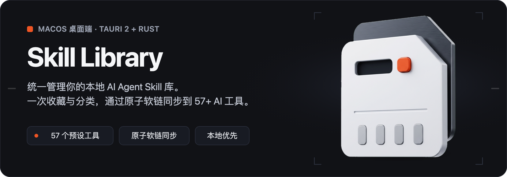
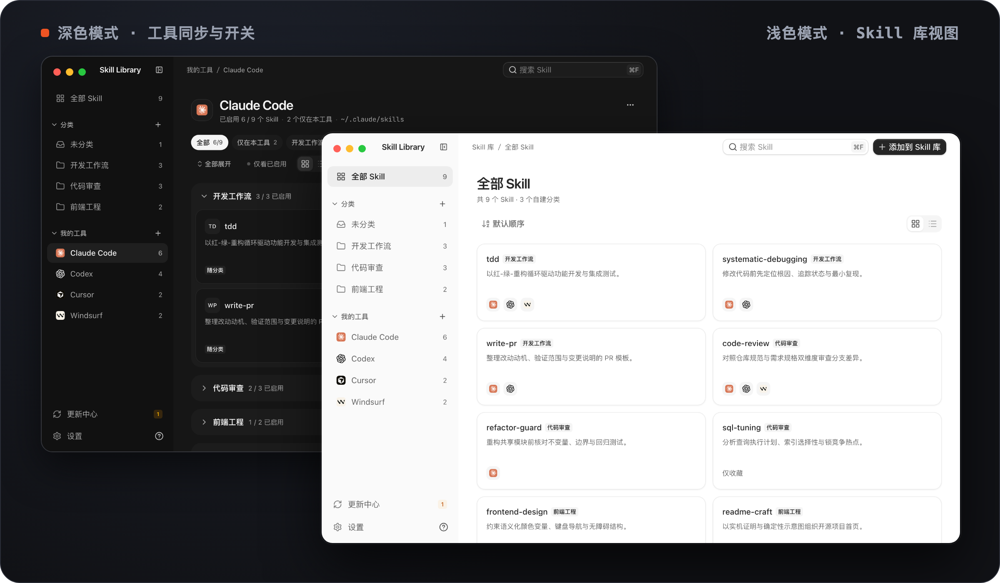
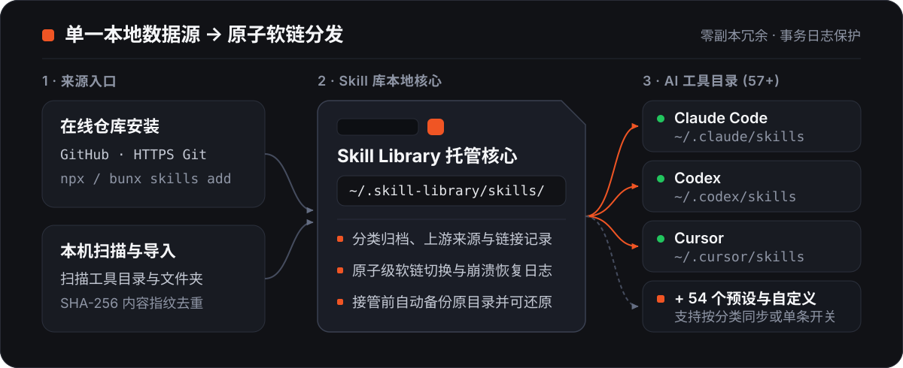

<p align="center">
  
</p>

<p align="center">
  <strong>简体中文</strong> · <a href="./README.en.md">English</a>
  &nbsp;&nbsp;|&nbsp;&nbsp;
  <a href="#核心能力">核心能力</a> ·
  <a href="#工作机制">工作机制</a> ·
  <a href="#支持的-ai-工具">支持工具</a> ·
  <a href="#安装与快速开始">安装与上手</a> ·
  <a href="#本地开发">本地开发</a>
</p>

**Skill Library** 是一款本地优先的 macOS 桌面应用（基于 **Tauri 2**、**Rust** 与 **React 19** 构建）。它把分散在各处的 AI Skill 收进同一个本地 **Skill 库**（默认 `~/.skill-library/skills/`），再通过带事务保护的原子软链按需同步给 **57 个预设 AI 工具**及自定义目录。

<p align="center">
  
</p>

---

## 核心能力

当你同时使用 Claude Code、Codex、Cursor、Windsurf、Gemini CLI 等多个 AI 编程工具时，同一份 `SKILL.md` 往往会在各工具的隐藏目录里重复存放、各自漂移。**Skill Library** 用单一本地数据源替代重复副本：

- **单一 Skill 库，按工具精确开关与整类同步** — 在「全部 Skill」「未分类」或自定义分类下浏览与整理；到「我的工具」逐条开启 Skill，或直接开启某分类的「自动同步」，同时保留单条停用排除与一键撤销。
- **本机扫描、SHA-256 指纹去重与安全接管** — 自动扫描已有工具目录与指定文件夹：内容完全一致的 Skill 通过 SHA-256 去重，仅保存一份；同名但内容不同时可先对比 manifest Diff 再决定保留两份或统一版本。
  - **本地导入**：收藏一份到 Skill 库，原位置文件保持独立。
  - **接管**：将该工具目录切换为使用 Skill 库维护的软链，并在切换前自动备份原工具文件夹。
- **在线安装与更新中心（Skill 更新）** — 直接支持以下来源格式：
  - HTTPS Git 仓库链接（支持 `#ref=...` 指定分支、标签或提交）
  - GitHub 简写 `owner/repo` 及目录链接（`https://github.com/<owner>/<repo>/tree/...`）
  - 命令片段：`npx`、`pnpx`、`pnpm dlx`、`bunx` 搭配 `skills add ...`（含 `--skill` / `-s` 筛选参数）
  在「更新中心」检查上游新版本、预览改动文件并执行 **Skill 更新**（无需重启应用；更新失败前各工具仍可继续使用旧版）。
- **原子事务存储、目录迁移与多重备份** — 每次软链切换均写入崩溃恢复日志，并校验 `inode` 与创建时间归属；支持迁移托管目录、导出/导入全库 JSON 备份（替换前预览影响范围），以及管理接管原文件夹备份的保留策略（`30 天` / `7 天` / `仅手动清理`）。
- **原生 macOS 桌面交互** — 完整浅色 / 深色 / 跟随系统主题与中英文双语界面、Overlay 无边框标题栏、快捷键搜索（`⌘F`）、`Shift` 连选、拖拽排序分类与工具，以及基于 GitHub Releases 签名校验的客户端 **应用更新**（「设置 → 关于与更新」）。

---

## 工作机制

<p align="center">
  
</p>

1. **托管库与外部工具目录分离** — Skill 的真实文件集中保存在本地托管目录（默认 `~/.skill-library/skills/`）。各工具目录中仅维护当前已启用或随分类自动同步的软链，不产生多余副本。
2. **Skill 更新与应用更新职责分离** — 侧栏「更新中心」专门负责管理库内 **Skill 更新**（不会重启应用）；客户端本体的 **应用更新** 统一放在「设置 → 关于与更新」，通过 `tauri-plugin-updater` 从 GitHub Releases 获取签名更新包。

---

## 支持的 AI 工具

内置 **57 个常用 AI 工具预设**，并支持任意数量与任意路径的 **自定义 Agent**：

> **常见预设：** Claude Code · Codex · Cursor · Antigravity · Gemini CLI · GitHub Copilot · Windsurf · TRAE IDE · Cline · OpenCode · Roo Code · Kilo Code · Goose · Warp · Augment · Amp

<details>
<summary>展开查看全部 57 个内置 AI 工具预设及默认用户级目录</summary>

| 工具名称 | 默认用户级 Skill 目录 | 工具名称 | 默认用户级 Skill 目录 |
| --- | --- | --- | --- |
| Claude Code | `~/.claude/skills` | Codex | `~/.codex/skills`（或 `$CODEX_HOME/skills`） |
| Cursor | `~/.cursor/skills` | OMP Agent | `~/.omp/agent/skills` |
| Grok | `~/.grok/skills` | OpenCode | `~/.config/opencode/skills` |
| Antigravity | `~/.gemini/config/skills` | Amp | `~/.config/agents/skills` |
| Kilo Code | `~/.kilocode/skills` | Roo Code | `~/.roo/skills` |
| Goose | `~/.config/goose/skills` | Gemini CLI | `~/.gemini/skills` |
| GitHub Copilot | `~/.copilot/skills` | OpenClaw | `~/.openclaw/skills` |
| Droid | `~/.factory/skills` | Windsurf | `~/.codeium/windsurf/skills` |
| TRAE IDE | `~/.trae/skills` | Shared Skills | `~/.agents/skills` |
| Cline | `~/.agents/skills` | Deep Agents | `~/.deepagents/agent/skills` |
| Firebender | `~/.firebender/skills` | Kimi Code CLI | `~/.kimi-code/skills` |
| Replit | `~/.config/agents/skills` | Warp | `~/.agents/skills` |
| Augment | `~/.augment/skills` | IBM Bob | `~/.bob/skills` |
| CodeBuddy | `~/.codebuddy/skills` | Command Code | `~/.commandcode/skills` |
| Continue | `~/.continue/skills` | Cortex Code | `~/.snowflake/cortex/skills` |
| Crush | `~/.config/crush/skills` | iFlow CLI | `~/.iflow/skills` |
| Junie | `~/.junie/skills` | Kiro CLI | `~/.kiro/skills` |
| Kode | `~/.kode/skills` | MCPJam | `~/.mcpjam/skills` |
| Mistral Vibe | `~/.vibe/skills` | Mux | `~/.mux/skills` |
| Neovate | `~/.neovate/skills` | OpenHands | `~/.openhands/skills` |
| Pi | `~/.pi/agent/skills` | Pochi | `~/.pochi/skills` |
| Qoder | `~/.qoder/skills` | Qwen Code | `~/.qwen/skills` |
| TRAE CN | `~/.trae-cn/skills` | Zencoder | `~/.zencoder/skills` |
| ZCode | `~/.zcode/skills` | AdaL | `~/.adal/skills` |
| Hermes Agent | `~/.hermes/skills` | QClaw | `~/.qclaw/skills` |
| EasyClaw | `~/.easyclaw/skills` | AutoClaw | `~/.openclaw-autoclaw/skills` |
| WorkBuddy | `~/.workbuddy/skills` | WorkBuddy AI | `~/.workbuddy-ai/skills` |
| DeepSeek Harness | `~/.dsh/skills` | GitLab Duo | `~/.gitlab/duo/skills` |
| MiniMax Code | `~/.minimax/skills` | *自定义 Agent* | *Skill 库以外的任意可写目录* |

</details>

---

## 安装与快速开始

### macOS 安装包

前往 [GitHub Releases](https://github.com/sunyifeng11111/skill-library/releases) 下载对应芯片架构的 `.dmg` 安装包（Apple Silicon 选 `aarch64-apple-darwin`，Intel 选 `x86_64-apple-darwin`）：

1. 打开 `.dmg`，将 **Skill Library.app** 拖入 **应用程序（Applications）** 目录（注意：直接从只读 `.dmg` 镜像中启动时无法执行应用内自动更新覆盖）。
2. 若当前版本采用免费 ad-hoc 签名而未经过 Apple 公证，首次打开被 Gatekeeper 拦截时请在终端执行一次：

```bash
xattr -cr "/Applications/Skill Library.app"
```

### 60 秒快速上手

1. **添加工具** — 在侧栏「我的工具 → `+`」勾选本机使用的 AI 工具，或指定自定义目录。
2. **导入或安装 Skill** — 点击「添加到 Skill 库」，扫描本机已有工具/文件夹（自动 SHA-256 去重），或粘贴 GitHub 链接 / `npx skills add ...` 命令在线安装。
3. **按工具同步与开关** — 进入对应工具页面，打开单个 Skill 开关或开启整类「自动同步」。

### 从源码构建

环境要求：**macOS**、**Node.js 22+**、**Rust**（stable 工具链）及 Xcode Command Line Tools。

```bash
npm install
npm run tauri dev
```

打包本地 macOS `.app` 与 `.dmg`：

```bash
npm run tauri build
```

---

## 本地开发

| 层级 | 技术栈 |
| --- | --- |
| 桌面壳与核心引擎 | Tauri 2 · Rust (2021) · `sha2` · `fs2` · `tar` · `tauri-plugin-updater` |
| 前端界面 | React 19 · TypeScript · Tailwind CSS v4 · `@base-ui/react` · `cosscom/ui` · Lucide |
| 自动化测试 | Vitest + `@testing-library/react`（前端）· Cargo tests（Rust 后端） |

运行测试与构建检查：

```bash
# 前端交互与单元测试
npm test

# TypeScript 类型检查与 Vite 构建
npm run build

# Rust 核心引擎与集成测试
cargo test --manifest-path src-tauri/Cargo.toml
```

如需配置发布签名密钥（minisign）、GitHub Actions 自动发布与本地更新联调，请参阅 [docs/releasing.md](./docs/releasing.md)。

---

## 平台状态与致谢

- **平台支持**：目前已完成并在 CI 中构建 macOS（`aarch64-apple-darwin` 与 `x86_64-apple-darwin`）；Windows 与 Linux 支持已在发布工作流矩阵中预留。
- **致谢**：
  - 内置工具默认目录列表参考 `xingkongliang/skills-manager`（许可声明见 [public/licenses/skills-manager.txt](./public/licenses/skills-manager.txt)）
  - 界面基础原语基于 [Base UI](https://base-ui.com/) 与 [cosscom/ui](https://github.com/cosscom/ui)
  - 图标与第三方许可声明见 [public/licenses/octicons.txt](./public/licenses/octicons.txt)
  - README 视觉与排版由 [beautify-github-readme](https://github.com/oil-oil/beautify-github-readme) 辅助生成
- **商标声明**：[src/features/agents/logos](./src/features/agents/logos) 中的第三方 AI 工具名称与图标版权及商标均归各自所有者所有，仅用于标识工具目录兼容性，不代表官方关联或背书。

---

## 开源协议

MIT © 2026 yifeng — 详见 [LICENSE](./LICENSE)。
